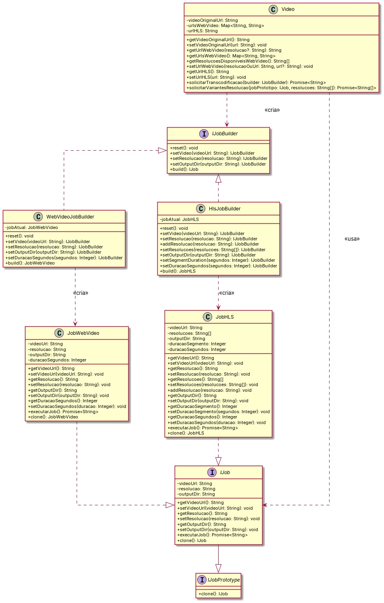
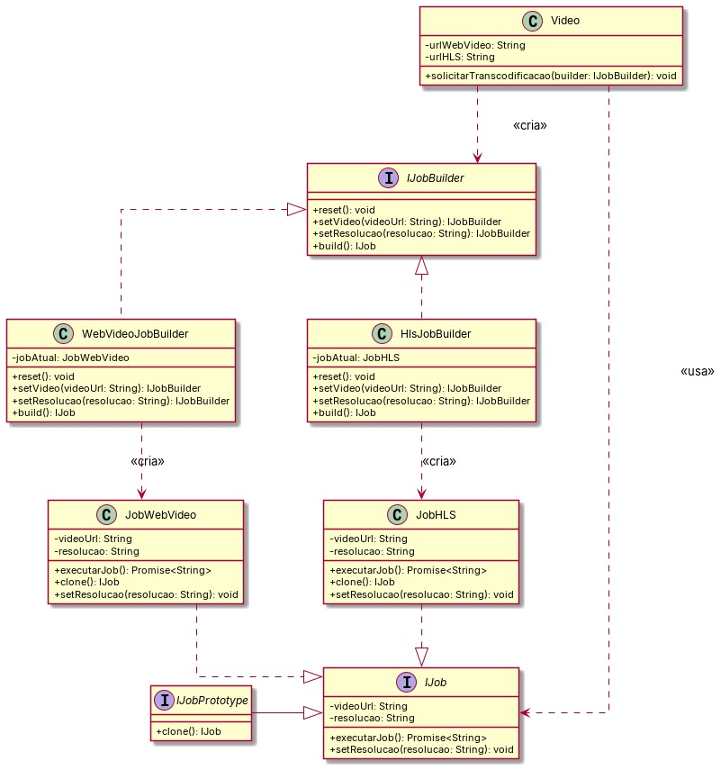
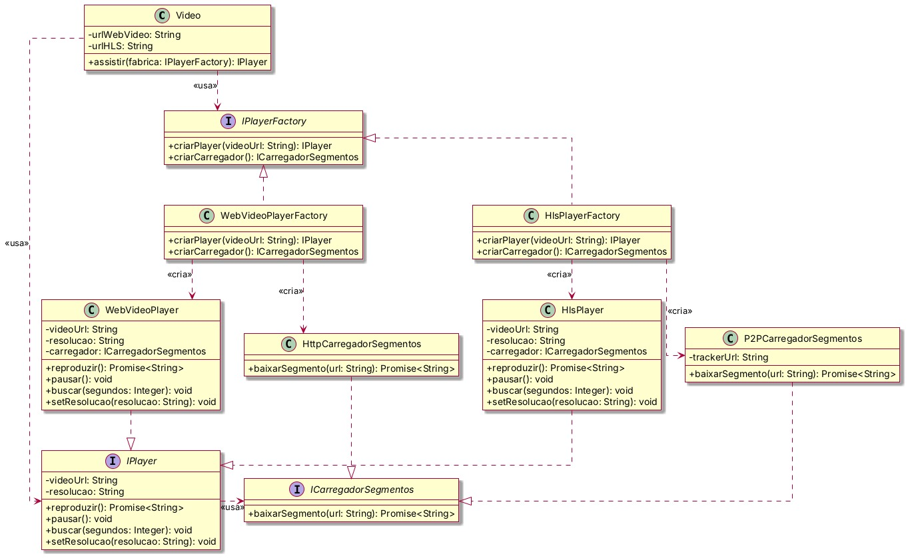

# SubEquipe_03

## Focos do Relatório

### FOCO_03: GoFs Criacionais & IA Generativa

### Participantes no Foco_03

| Nome do Membro | Lições Aprendidas | Uso da IA Generativa (SENSO CRÍTICO) |
| :------------- | :---------------- | :----------------------------------- |
| [José Augusto](https://github.com/JaugustoM) | Pude aprofundar significativamente meus conhecimentos em padrões de projeto e arquitetura de software. Embora já possuísse experiência prática por meio da utilização de frameworks, ainda não dominava a fundamentação conceitual e teórica de cada solução. | O uso de IA generativa ficou concentrado na geração de código após a definição prévia da arquitetura. Utilizei o Antigravity com o modelo Gemini 3.8 Flash e obtive uma experiência bastante positiva: o agente compreendeu a arquitetura a partir do diagrama e gerou código funcional com mínima necessidade de ajustes. |
| [Pedro Lucas](https://github.com/pwdrinho) | Nesta entrega, aprofundei meu entendimento sobre padrões de projeto e percebi com mais clareza sua conexão com os conteúdos de modelagem. A arquitetura ainda representava uma das minhas principais dificuldades conceituais; contudo, ao correlacionar os diagramas à implementação em código, compreendi como cada decisão estrutural faz sentido no sistema. Essa dinâmica permitiu transpor a teoria para a prática, embora reconheça a importância de continuar os estudos para consolidar o domínio no tema. | Utilizei o Claude Code como apoio na elaboração dos códigos relativos aos Builders, sobretudo por estar em fase de adaptação à linguagem adotada pelo grupo. Acompanhei toda a lógica desenvolvida e utilizei a ferramenta como suporte para acelerar a compreensão e a implementação, além da formatação de tabelas. O ChatGPT foi empregado para correções ortográficas e refinamento da redação. As ferramentas otimizaram o fluxo de trabalho, sendo utilizadas com senso crítico como suporte ao aprendizado. |
| [Giovana Barbosa](https://github.com/gio221) | Aprendi na prática o funcionamento do Abstract Factory e sua distinção frente a outros padrões criacionais, em especial o Factory Method. Também compreendi a estratégia de entrega de vídeos no PeerTube — com o HLS segmentando a mídia para distribuição P2P entre espectadores e o WebVideo fornecendo o arquivo contínuo via HTTP. Adicionalmente, desenvolvi diagramas de classes no PlantUML e vivenciei a importância do alinhamento técnico contínuo na equipe. | No escopo de reprodução, utilizamos o Claude (Anthropic) como ferramenta de apoio. O assistente auxiliou no esclarecimento de dúvidas conceituais sobre padrões criacionais, na avaliação de adequação ao problema, na estruturação do diagrama do Abstract Factory e no entendimento do HLS no PeerTube. Todo o conteúdo gerado foi criteriosamente revisado, ajustado e validado pela equipe antes da integração à documentação. |

### Metodologia do Foco_03

O trabalho do Foco_03 foi conduzido de forma colaborativa e incremental, reaproveitando e evoluindo os artefatos que o próprio subgrupo produziu na [Entrega 1](https://unbarqdsw2026-2-turma02.github.io/2026.2_T02_G3_ProjetoStreamingVideo_Entrega_01/#/Base/Relat%C3%B3rios/1.1.3.SubEquipe_03/1.1.3.SubEquipe_03) e na [Entrega 2](https://unbarqdsw2026-2-turma02.github.io/2026.2_T02_G3_ProjetoStreamingVideo_Entrega_02/#/Base/Relat%C3%B3rios/SubEquipe_03/1.ModelagemEstatica) (domínio VOD/PeerTube, entidade `Video` e fluxos de transcodificação e reprodução).

Inicialmente, analisamos a modelagem das entregas anteriores para fundamentar a escolha e o escopo dos padrões GoF criacionais a serem adotados. Em seguida, refinamos a modelagem UML estática em diagramas de classes e avançamos para a implementação em TypeScript acompanhada de testes unitários automatizados para cada padrão.

Como iniciativa extra necessária para execução dos códigos implementados, trouxemos o artefato [ferramentas](../../../IniciativasExtras/ferramentas.md), com alguns comandos para executar os códigos e dependencias externas.

### GoFs Criacionais

| | GoF Criacional 1 | GoF Criacional 2 |
| :-- | :-- | :-- |
| **Tema** | VOD: **Transcodificação** de vídeo | VOD: **Reprodução** (assistir vídeo) |
| **Padrões** | **Builder** + **Prototype** | **Abstract Factory** |
| **Situação** | Contexto, modelo, código e testes prontos | Contexto, modelo, código e testes prontos |
| **Seção** | [GoF Criacional 1](#gof-criacional-1-vod-transcodificação-builder--prototype) | [GoF Criacional 2](#gof-criacional-2-vod-reprodução-abstract-factory) |

#### GoF Criacional 1: VOD Transcodificação (Builder + Prototype)

> Escopo desta seção: **preparar o vídeo** para entrega, gerando MP4 (WebVideo) e HLS em várias resoluções. Utiliza as interfaces `IJob`, `IJobPrototype` e `IJobBuilder`.

<a id="contexto-problema"></a>
##### Contexto (Problema)

Em uma plataforma de *Video On Demand* (VOD) como o PeerTube, os vídeos enviados pelos usuários precisam ser transcodificados para diferentes formatos e resoluções antes de serem disponibilizados para reprodução. No sistema modelado, o processamento de mídia atende a dois formatos de entrega:

1. **Web Video (MP4):** arquivo único otimizado para reprodução direta via HTTP.
2. **HLS (*HTTP Live Streaming*):** vídeo segmentado com arquivos de índice (`.m3u8`) e suporte a múltiplas resoluções para reprodução adaptativa.

A criação e execução dessas tarefas de transcodificação apresentam dois problemas de projeto de software:

- <a id="problema-configuracao-jobs"></a>**Configuração de jobs com múltiplos parâmetros e formatos distintos:** criar tarefas de transcodificação envolve definir caminhos de entrada e saída, resoluções, limites de duração e tempos de segmentação. Fazer essa instanciação diretamente na classe `Video` gera alto acoplamento e construtores com muitos parâmetros.
- <a id="problema-geracao-resolucoes"></a>**Geração repetitiva de resoluções para o mesmo vídeo:** para suportar streaming adaptativo ou diferentes qualidades (ex.: 1080p, 720p, 480p), o sistema precisa criar múltiplos jobs com os mesmos parâmetros-base, alterando apenas a resolução-alvo. Recriar cada job do início gera duplicação de lógica e validação redundante.[¹](#ref1)[³](#ref3)

Para resolver esses pontos, foram aplicados os padrões GoF Criacionais **Builder** e **Prototype**:

###### GoF Builder
- **Como é utilizado:** a interface `IJobBuilder` e suas implementações concretas (`WebVideoJobBuilder` e `HlsJobBuilder`) fornecem métodos para montar passo a passo instâncias de `JobWebVideo` e `JobHLS`. A classe `Video` atua como cliente ao invocar o builder por meio do método `solicitarTranscodificacao(builder: IJobBuilder)`.
- **Benefícios:**
  - Separa o processo de construção dos jobs de sua representação final.[¹](#ref1)[²](#ref2)
  - Elimina construtores sobrecarregados na instanciação dos jobs.
  - Permite criar diferentes tipos de saída (MP4 único ou pacote HLS segmentado) usando uma mesma interface de construção.
  - Facilita a extensão para novos formatos de transcodificação sem alterar a classe `Video`.

###### GoF Prototype
- **Como é utilizado:** a interface `IJob` estende `IJobPrototype`, exigindo a implementação do método `clone()` nas classes concretas `JobWebVideo` e `JobHLS`. No método `solicitarVariantesResolucao(jobPrototipo: IJob, resolucoes: string[])`, a classe `Video` recebe um job-base já configurado, clona sua instância para cada resolução desejada e atualiza apenas a propriedade `resolucao` antes da execução.
- **Benefícios:**
  - Elimina a necessidade de reconstruir e revalidar todos os parâmetros do job (URL original, diretório de saída, durações) para cada resolução gerada.[³](#ref3)
  - Garante consistência entre todas as variantes de um mesmo vídeo, pois todas compartilham a mesma configuração-base herdada do protótipo.
  - Reduz o acoplamento do método de geração de variantes, que opera sobre a interface `IJob` sem precisar saber qual classe concreta está sendo clonada.[¹](#ref1)

###### Como os dois padrões se complementam
O **Builder** monta o job-base uma única vez (com configuração completa); o **Prototype** o replica por resolução. Enquanto o Builder responde "*como montar*", o Prototype responde "*como copiar o que já está pronto com eficiência*" [¹](#ref1)[²](#ref2)[³](#ref3).

##### Modelagem (Notação UML)

Versão Atual:



*Figura 1 — GoF Criacional 1: VOD Transcodificação v2.0. Autoria: [Giovana Barbosa](https://github.com/gio221), [José Augusto](https://github.com/JaugustoM) e [Pedro Lucas](https://github.com/pwdrinho).*

[Ver código referente ao GoF Criacional 1: VOD Transcodificação v2.0](./../../../assets/SubGrupo03/gofcriacional_transcodificacao_v.2.puml)

<details>
<summary><b>Ver Versão 1.0</b></summary>

Essa versão não incluía os métodos e atributos que foram implementados no código.



*Figura 2 — GoF Criacional 1: VOD Transcodificação v1.0. Autoria: [José Augusto](https://github.com/JaugustoM) e [Pedro Lucas](https://github.com/pwdrinho).*

[Ver código referente ao GoF Criacional 1: VOD Transcodificação v1.0](./../../../assets/SubGrupo03/gofcriacional_transcodificacao_v.1.puml)

</details>

##### Implementação (Código & Vídeo com Padrão em Execução)

Como explicado anteriormente, o subsistema desenvolvido pela Subequipe 03 está relacionado à transcodificação de vídeos. O código que implementa esse subsistema, adotando os GoFs mencionados na seção [Contexto](#contexto-problema), localiza-se na pasta `backend/src/vod`. Abaixo, é apresentada uma análise do código produzido com os GoFs criacionais e, em seguida, a demonstração do código em funcionamento.

Dentro da pasta `backend/src/vod`, adota-se a seguinte estrutura de pastas e arquivos:

```text
backend/src/vod
├── __tests__/                     # Testes unitários para validação dos GoFs
│   └── vod.spec.ts
├── builders/                      # Implementação concreta das classes que implementam IJobBuilder
│   ├── hls-job.builder.ts
│   └── web-video-job.builder.ts
├── entities/                      # Implementação concreta da classe Video
│   └── video.entity.ts
├── interfaces/                    # Definição das interfaces IJobBuilder, IJobPrototype e IJob
│   ├── job-builder.interface.ts
│   ├── job-prototype.interface.ts
│   └── job.interface.ts
├── jobs/                          # Implementação concreta das classes que implementam IJob
│   ├── job-hls.ts
│   └── job-web-video.ts
├── utils/                         # Implementação de funções utilitárias para transcodificação via FFmpeg
│   └── ffmpeg.util.ts
├── index.ts                       # Centralização das exportações de módulos
└── transcode-target.ts            # Script de demonstração da pipeline de transcodificação
```

---

A seguir, são apresentadas as explicações de cada módulo relacionado aos GoFs **Builder** e **Prototype**. Para manter a concisão do documento, foram omitidos métodos acessores (*getters* e *setters*) e trechos operacionais secundários não diretamente acoplados aos padrões.

<details>
<summary><b>Explicação Detalhada do Código</b></summary>

###### Interfaces

**Interface `IJobPrototype`**
*Arquivo: [`job-prototype.interface.ts`](../../../../backend/src/vod/interfaces/job-prototype.interface.ts)*

A interface `IJobPrototype` define o contrato do **Prototype**. Exige a presença da operação `clone()`, permitindo que qualquer tipo de tarefa de transcodificação gere cópias idênticas e desacopladas de si mesma, preservando o estado interno sem que o cliente precise conhecer a classe concreta instanciada.

```typescript
export interface IJobPrototype {
  clone(): IJob;
}
```

**Interface `IJob`**
*Arquivo: [`job.interface.ts`](../../../../backend/src/vod/interfaces/job.interface.ts)*

A interface `IJob` unifica as responsabilidades de Produto do padrão **Builder** e de Protótipo Concreto ao herdar de `IJobPrototype`. Ela padroniza o acesso e a mutação das propriedades fundamentais da tarefa e expõe a operação assíncrona `executarJob()`, que efetua o processamento real de mídia via FFmpeg. O método `setResolucao` desempenha papel crítico na reutilização via protótipo: após a clonagem, apenas a resolução-alvo é ajustada, mantendo válidas as demais configurações-base.

```typescript
export interface IJob extends IJobPrototype {
  // ... Getters e Setters ...

  executarJob(): Promise<string>;
  clone(): IJob;
}
```

**Interface `IJobBuilder`**
*Arquivo: [`job-builder.interface.ts`](../../../../backend/src/vod/interfaces/job-builder.interface.ts)*

Define as etapas universais de montagem que qualquer construtor de job de vídeo deve contemplar: redefinição do estado (`reset`), configuração de entrada (`setVideo`), definição de resolução (`setResolucao`), diretório de saída (`setOutputDir`) e produção final da instância (`build`).

```typescript
export interface IJobBuilder {
  reset(): void;

  // ... Setters ...

  build(): IJob;
}
```

---

###### Implementações Concretas

**Builder de Job WebVideo (`WebVideoJobBuilder`)**
*Arquivo: [`web-video-job.builder.ts`](../../../../backend/src/vod/builders/web-video-job.builder.ts)*

Implementação concreta responsável por instanciar e parametrizar tarefas destinadas à reprodução direta via HTTP. Permite a construção do objeto por encadeamento de métodos (*fluent interface*) em vez de um construtor com múltiplos parâmetros, reinicializando seu estado interno a cada invocação de `build()` para garantir o isolamento entre construções.

```typescript
export class WebVideoJobBuilder implements IJobBuilder {
  private jobAtual: JobWebVideo;

  constructor() {
    this.reset();
  }

  public reset(): void {
    this.jobAtual = new JobWebVideo();
  }

  // ... Setters ...

  public build(): JobWebVideo {
    const jobPronto = this.jobAtual;
    this.reset();
    return jobPronto;
  }
}
```

**Builder de Job HLS (`HlsJobBuilder`)**
*Arquivo: [`hls-job.builder.ts`](../../../../backend/src/vod/builders/hls-job.builder.ts)*

Especializado na parametrização do `JobHLS`. Além dos métodos contratuais de `IJobBuilder`, provê operações específicas do protocolo HTTP Live Streaming, como `setResolucoes` e `addResolucao` para composição de múltiplas qualidades em uma Master Playlist, e `setSegmentDuration` para calibração da duração dos fragmentos `.ts`.

```typescript
export class HlsJobBuilder implements IJobBuilder {
  private jobAtual: JobHLS;

  constructor() {
    this.reset();
  }

  public reset(): void {
    this.jobAtual = new JobHLS();
  }

  public addResolucao(resolucao: string): this {
    this.jobAtual.addResolucao(resolucao);
    return this;
  }

  public setResolucoes(resolucoes: string[]): this {
    this.jobAtual.setResolucoes(resolucoes);
    return this;
  }

  public setSegmentDuration(segundos: number): this {
    this.jobAtual.setDuracaoSegmento(segundos);
    return this;
  }

  // ... Demais Setters ...

  public build(): JobHLS {
    const jobPronto = this.jobAtual;
    this.reset();
    return jobPronto;
  }
}
```

**Job WebVideo (`JobWebVideo`)**
*Arquivo: [`job-web-video.ts`](../../../../backend/src/vod/jobs/job-web-video.ts)*

Representa um processamento voltado para arquivos MP4 progressivos (com flags *faststart* para início imediato do streaming). No método `clone()`, cria uma nova instância de `JobWebVideo` transferindo todos os parâmetros já configurados, viabilizando que o cliente gere novas resoluções com custo mínimo de instanciação.

```typescript
export class JobWebVideo implements IJob {
  private videoUrl: string = '';
  private resolucao: string = '720p';
  private outputDir: string = './media/vod/web';
  private duracaoSegundos?: number;

  constructor(videoUrl?: string, resolucao?: string, outputDir?: string, duracaoSegundos?: number) {
    if (videoUrl) this.videoUrl = videoUrl;
    if (resolucao) this.resolucao = resolucao;
    if (outputDir) this.outputDir = outputDir;
    if (duracaoSegundos) this.duracaoSegundos = duracaoSegundos;
  }

  // ... Getters e Setters ...

  public async executarJob(): Promise<string> {
    // ... validação de parâmetros e existência do vídeo de origem ...
    // ... preparação do diretório de saída e sanitização da resolução ...
    // ... invocação do utilitário FFmpeg para transcodificação no formato MP4 (faststart) ...
    return outputPath;
  }

  public clone(): JobWebVideo {
    return new JobWebVideo(
      this.videoUrl,
      this.resolucao,
      this.outputDir,
      this.duracaoSegundos,
    );
  }
}
```

**Job HLS (`JobHLS`)**
*Arquivo: [`job-hls.ts`](../../../../backend/src/vod/jobs/job-hls.ts)*

Processa o vídeo original gerando a segmentação HLS em arquivos `.ts`, playlists secundárias por resolução (`index.m3u8`) e a lista-mestre unificada (`master.m3u8`). Ao executar `clone()`, produz uma cópia independente de todas as listas de resolução e opções de segmentação, viabilizando a instanciação paralela de perfis sem interferência mútua.

```typescript
export class JobHLS implements IJob {
  private videoUrl: string = '';
  private resolucoes: string[] = ['720p'];
  private outputDir: string = './media/vod/hls';
  private duracaoSegundos?: number;
  private duracaoSegmento: number = 4;

  constructor(
    videoUrl?: string,
    resolucoes?: string | string[],
    outputDir?: string,
    duracaoSegundos?: number,
    duracaoSegmento: number = 4,
  ) {
    if (videoUrl) this.videoUrl = videoUrl;
    if (resolucoes) {
      this.resolucoes = Array.isArray(resolucoes) ? [...resolucoes] : [resolucoes];
    }
    if (outputDir) this.outputDir = outputDir;
    if (duracaoSegundos) this.duracaoSegundos = duracaoSegundos;
    this.duracaoSegmento = duracaoSegmento;
  }

  // ... Getters e Setters ...

  public async executarJob(): Promise<string> {
    // ... validação dos parâmetros e existência do vídeo de entrada ...
    // ... criação dos diretórios das variantes e iteração sobre as resoluções configuradas ...
    // ... execução do FFmpeg para segmentação (.ts) e sub-playlists (.m3u8) por resolução ...
    // ... geração da Master Playlist unificada (master.m3u8) com perfis multivariantes ...
    return masterPlaylistPath;
  }

  public clone(): JobHLS {
    return new JobHLS(
      this.videoUrl,
      [...this.resolucoes],
      this.outputDir,
      this.duracaoSegundos,
      this.duracaoSegmento,
    );
  }
}
```

**Entidade Video (`Video`)**
*Arquivo: [`video.entity.ts`](../../../../backend/src/vod/entities/video.entity.ts)*

A classe `Video` atua como a entidade **Cliente** de ambos os padrões de projeto, desempenhando um papel central de orquestração:
1. **Consumidor do Builder (`solicitarTranscodificacao`):** recebe qualquer implementação de `IJobBuilder`, solicita a construção da tarefa via `build()`, injeta o caminho do vídeo original caso necessário e executa a transcodificação sem acoplamento com a classe concreta do job ou com seus detalhes operacionais de criação.
2. **Consumidor do Prototype (`solicitarVariantesResolucao`):** recebe uma tarefa prototípica já configurada e uma coleção de resoluções pretendidas. Para cada resolução, invoca `clone()`, altera somente a resolução-alvo (`setResolucao`) e executa o processamento.
3. **Gerenciamento de Múltiplas URLs de WebVideo:** armazena internamente um `Map<string, string>` denominado `urlsWebVideo`. À medida que cada resolução é transcodificada, seu endereço é registrado pela chave correspondente. No caso da transcodificação HLS, isso não é necessário, pois é gerada uma única Master Playlist contendo todas as resoluções.

```typescript
export class Video {
  private videoOriginalUrl: string = '';
  private urlsWebVideo: Map<string, string> = new Map<string, string>();
  private urlHLS: string = '';

  constructor(videoOriginalUrl: string = '') {
    this.videoOriginalUrl = videoOriginalUrl;
  }

  // ... Getters e Setters ...

  public async solicitarTranscodificacao(builder: IJobBuilder): Promise<string> {
    const job = builder.build();

    if (!job.getVideoUrl() && this.videoOriginalUrl) {
      job.setVideoUrl(this.videoOriginalUrl);
    }

    const resultado = await job.executarJob();

    if (job instanceof JobWebVideo) {
      this.urlsWebVideo.set(job.getResolucao(), resultado);
    } else if (job instanceof JobHLS) {
      this.urlHLS = resultado;
    }

    return resultado;
  }

  public async solicitarVariantesResolucao(
    jobPrototipo: IJob,
    resolucoes: string[],
  ): Promise<string[]> {
    const resultados: string[] = [];

    for (const resolucao of resolucoes) {
      const jobClonado = jobPrototipo.clone();
      jobClonado.setResolucao(resolucao);

      const pathGerado = await jobClonado.executarJob();
      resultados.push(pathGerado);

      if (jobClonado instanceof JobWebVideo) {
        this.urlsWebVideo.set(resolucao, pathGerado);
      } else if (jobClonado instanceof JobHLS && !this.urlHLS) {
        this.urlHLS = pathGerado;
      }
    }

    return resultados;
  }
}
```

</details>

###### Execução do Pipeline de Transcodificação

O script `transcode-target.ts` realiza a transcodificação do vídeo nos dois formatos suportados por meio dos builders (`WebVideoJobBuilder` e `HlsJobBuilder`) e, em seguida, emprega o método `clone()` do protótipo para gerar variantes de menor resolução para o `JobWebVideo`. O log a seguir evidencia a execução real da pipeline:

```text
=====================================================
🎥 VOD Transcoding Pipeline - GoF Criacional Demo
   Padrões: Builder + Prototype
=====================================================

📁 Vídeo alvo: /home/jaugusto/Projects/Arquitetura/2026.2_T02_G3_ProjetoStreamingVideo_Entrega_03/media/vod/raw_video.mp4
⏱️ Modo: Completo (16 min)
📂 Diretório de saída: /home/jaugusto/Projects/Arquitetura/2026.2_T02_G3_ProjetoStreamingVideo_Entrega_03/media/vod

⚙️ [1/3] Construindo e executando Job WebVideo (MP4 Faststart)...
✅ WebVideo gerado com sucesso:
   - Caminho: /home/jaugusto/Projects/Arquitetura/2026.2_T02_G3_ProjetoStreamingVideo_Entrega_03/media/vod/web/raw_video_720p.mp4
   - Tamanho: 43.53 MB
   - Video.urlWebVideo: /home/jaugusto/Projects/Arquitetura/2026.2_T02_G3_ProjetoStreamingVideo_Entrega_03/media/vod/web/raw_video_720p.mp4

⚙️ [2/3] Construindo e executando Job HLS com Master Playlist unificada...
✅ HLS Master Playlist gerada com sucesso para hls.js:
   - Master Playlist: /home/jaugusto/Projects/Arquitetura/2026.2_T02_G3_ProjetoStreamingVideo_Entrega_03/media/vod/hls/raw_video/master.m3u8
   - Video.urlHLS: /home/jaugusto/Projects/Arquitetura/2026.2_T02_G3_ProjetoStreamingVideo_Entrega_03/media/vod/hls/raw_video/master.m3u8
   - Variantes criadas:
     * 720p: /home/jaugusto/Projects/Arquitetura/2026.2_T02_G3_ProjetoStreamingVideo_Entrega_03/media/vod/hls/raw_video/720p/index.m3u8 (101 segmentos .ts)
     * 480p: /home/jaugusto/Projects/Arquitetura/2026.2_T02_G3_ProjetoStreamingVideo_Entrega_03/media/vod/hls/raw_video/480p/index.m3u8 (98 segmentos .ts)
     * 360p: /home/jaugusto/Projects/Arquitetura/2026.2_T02_G3_ProjetoStreamingVideo_Entrega_03/media/vod/hls/raw_video/360p/index.m3u8 (98 segmentos .ts)

⚙️ [3/3] Aplicando padrão PROTOTYPE para gerar variantes de resolução...
   - Job Protótipo base configurado: Resolução 720p
   - Clonando protótipo para gerar resoluções: 480p e 360p...
   ✅ Variante gerada via Clone:
      - Arquivo: raw_video_480p.mp4
      - Caminho: /home/jaugusto/Projects/Arquitetura/2026.2_T02_G3_ProjetoStreamingVideo_Entrega_03/media/vod/variantes/raw_video_480p.mp4
      - Tamanho: 27859.03 KB
   ✅ Variante gerada via Clone:
      - Arquivo: raw_video_360p.mp4
      - Caminho: /home/jaugusto/Projects/Arquitetura/2026.2_T02_G3_ProjetoStreamingVideo_Entrega_03/media/vod/variantes/raw_video_360p.mp4
      - Tamanho: 22928.70 KB

🎯 URLs WebVideo disponíveis na entidade Video (seleção por resolução pela aplicação cliente):
   - [720p]: /home/jaugusto/Projects/Arquitetura/2026.2_T02_G3_ProjetoStreamingVideo_Entrega_03/media/vod/web/raw_video_720p.mp4
   - [480p]: /home/jaugusto/Projects/Arquitetura/2026.2_T02_G3_ProjetoStreamingVideo_Entrega_03/media/vod/variantes/raw_video_480p.mp4
   - [360p]: /home/jaugusto/Projects/Arquitetura/2026.2_T02_G3_ProjetoStreamingVideo_Entrega_03/media/vod/variantes/raw_video_360p.mp4

=====================================================
🎉 Transcodificação concluída com sucesso!
   Padrões GoF Builder e Prototype validados em tempo de execução.
=====================================================
```

##### Rastreabilidade (GoF VOD Transcodificação)

| Problema | Padrão / Participante | Modelo (UML) | Código | Teste |
| :-- | :-- | :-- | :-- | :-- |
| [Configuração de jobs com múltiplos parâmetros e formatos distintos](#problema-configuracao-jobs) | Builder: `IJobBuilder` | `IJobBuilder` | `interfaces/job-builder.interface.ts` | `vod.spec.ts` (Builder) |
| [Configuração de jobs com múltiplos parâmetros e formatos distintos](#problema-configuracao-jobs) | ConcreteBuilder | `WebVideoJobBuilder`, `HlsJobBuilder` | `builders/*.builder.ts` | `vod.spec.ts` (Builder) |
| [Configuração de jobs com múltiplos parâmetros e formatos distintos](#problema-configuracao-jobs) | Product | `JobWebVideo`, `JobHLS` | `jobs/*.ts` | `vod.spec.ts` (execução FFmpeg) |
| [Configuração de jobs com múltiplos parâmetros e formatos distintos](#problema-configuracao-jobs) | Client | `Video.solicitarTranscodificacao` | `entities/video.entity.ts` | `vod.spec.ts` (Cliente) |
| [Geração repetitiva de resoluções para o mesmo vídeo](#problema-geracao-resolucoes) | Prototype: `IJobPrototype.clone()` | `IJobPrototype`, `IJob` | `interfaces/job-prototype.interface.ts` | `vod.spec.ts` (Prototype) |
| [Geração repetitiva de resoluções para o mesmo vídeo](#problema-geracao-resolucoes) | ConcretePrototype | `JobWebVideo.clone`, `JobHLS.clone` | `jobs/job-web-video.ts`, `jobs/job-hls.ts` | `vod.spec.ts` (Prototype) |
| [Geração repetitiva de resoluções para o mesmo vídeo](#problema-geracao-resolucoes) | Client | `Video.solicitarVariantesResolucao` | `entities/video.entity.ts` | `vod.spec.ts` (Cliente) |

##### Discussão Crítica (GoF VOD Transcodificação)

- **Builder sem *Director*:** O padrão GoF prevê, opcionalmente, uma classe *Director* responsável por encapsular a ordem das etapas de construção [¹](#ref1)[²](#ref2). No modelo adotado, o próprio cliente (`transcode-target.ts` ou a classe `Video`) conduz as invocações. Essa decisão atende plenamente ao escopo atual; no entanto, rotinas repetitivas (como um "perfil padrão HLS 720p/480p/360p") poderiam ser futuramente extraídas para um *Director*.
- **Prototype sem registro de protótipos (*Prototype Manager*):** O GoF sugere o uso de um repositório centralizado (*Prototype Manager*) em cenários dinâmicos [¹](#ref1). No projeto, optou-se por fornecer a instância prototípica diretamente como parâmetro no método do cliente, tornando a arquitetura mais simples e direta.
- **`setResolucao` na clonagem de `JobHLS`:** Na classe `JobHLS`, o método `setResolucao` substitui o conjunto de resoluções por uma única resolução específica. Esse comportamento é coerente para gerar variantes isoladas e está validado por testes automatizados (`vod.spec.ts`), embora deva ser levado em conta por desenvolvedores que esperem inserção incremental de resoluções.
- **Custo versus benefício:** Enquanto o Builder exige configuração passo a passo, o Prototype elimina esse custo por meio da clonagem. A combinação de ambos permitiu evitar duplicações de código sem comprometer a legibilidade arquitetural [¹](#ref1)[²](#ref2)[³](#ref3).
- **Código gerado com apoio de IA:** A integridade do código gerado com assistência de ferramentas de IA generativa foi assegurada por testes unitários e pela execução real da pipeline sobre arquivos de vídeo, evidenciando que a supervisão e validação humana permanecem essenciais.

#### GoF Criacional 2: VOD Reprodução (Abstract Factory)

> Escopo desta seção: **assistir ao vídeo** já transcodificado, nos formatos WebVideo (MP4) e HLS. Utiliza as interfaces `IPlayerFactory`, `IPlayer` e `ICarregadorSegmentos`.

<a id="contexto-problema-reproducao"></a>

##### Contexto (Problema)

Após o processamento realizado pelo GoF Criacional 1, o vídeo fica disponível em dois formatos distintos, demandando estratégias diferentes de reprodução:

1. **Web Video (MP4):** o player consome um arquivo único, transferido diretamente do servidor via HTTP progressivo.
2. **HLS (*HTTP Live Streaming*):** o player lê a Master Playlist (`master.m3u8`), seleciona a resolução adequada e faz o download contínuo dos segmentos `.ts`. Inspirando-se no PeerTube, esses fragmentos podem ser transferidos via rede ponto a ponto (P2P) entre espectadores, recorrendo ao servidor HTTP caso os fragmentos não estejam disponíveis no *swarm*.[⁶](#ref6)

Esse cenário gera um desafio essencial de projeto de software:

- <a id="problema-familias-reproducao"></a>**Criação de objetos de reprodução que precisam ser compatíveis entre si:** para assistir a um vídeo, são necessários dois objetos complementares: um **player**, encarregado do controle da reprodução, e um **carregador de segmentos**, responsável por recuperar os dados de mídia. Ambos dependem intrinsecamente do formato de entrega, e combinações incompatíveis geram falhas de execução (por exemplo, associar um player de MP4 único a um carregador P2P, que requer mídias segmentadas). Caso a entidade `Video` realizasse a instanciação direta desses componentes, ficaria fortemente acoplada a todas as classes concretas e assumiria a responsabilidade indevida de orquestrar a consistência das combinações.[¹](#ref1)[⁵](#ref5)

Para solucionar esse problema, foi adotado o padrão GoF Criacional **Abstract Factory**:

###### GoF Abstract Factory
- **Como é utilizado:** a interface `IPlayerFactory` define as operações para criação de uma família de objetos interdependentes de reprodução (`criarPlayer` e `criarCarregador`). As fábricas concretas `WebVideoPlayerFactory` e `HlsPlayerFactory` instanciam, respectivamente, a família `WebVideoPlayer` + `HttpCarregadorSegmentos` e a família `HlsPlayer` + `P2PCarregadorSegmentos`. A classe `Video` atua como cliente no método `assistir(fabrica: IPlayerFactory)`, retornando uma instância de `IPlayer` pronta para execução.
- **Benefícios:**
  - Garante a compatibilidade estrita entre player e carregador, centralizando as decisões de combinação exclusivamente na fábrica correspondente.[¹](#ref1)[⁵](#ref5)
  - Desacopla o cliente das classes concretas: quem consome o player interage apenas com a interface `IPlayer` (`reproduzir`, `pausar`, `buscar`, `setResolucao`).
  - Favorece a extensibilidade: novos perfis de reprodução (por exemplo, transmissão ao vivo ou WebTorrent) podem ser incorporados como novas fábricas e produtos sem modificar o código existente.
  - Adere à arquitetura real do PeerTube, na qual o fluxo HLS opera via P2P e o WebVideo ocorre por HTTP direto.

###### Por que não outros padrões criacionais?
- **Factory Method:** criaria apenas o objeto do player isoladamente, sem assegurar a compatibilidade com a estratégia do carregador. O problema demanda a criação coordenada de uma **família** de produtos correlacionados.[⁴](#ref4)
- **Builder:** o processo de instanciação do player não envolve múltiplas etapas complexas de montagem; o desafio reside na seleção coesa do par correto de componentes.
- **Prototype:** não há custo elevado na configuração do player que justifique clonagem, visto que cada sessão de reprodução instancia um player com parâmetros próprios.

###### Como os GoFs 1 e 2 se complementam
Enquanto o **Builder** e o **Prototype** respondem a "*como produzir*" cada formato de vídeo, o **Abstract Factory** responde a "*como consumir*" cada formato. Assim, as saídas geradas na pipeline de transcodificação (`urlsWebVideo` e `urlHLS`) funcionam como dados de entrada para o fluxo de reprodução, permitindo que a `master.m3u8` gerada pelo `JobHLS` seja consumida pelo `HlsPlayer`.

##### Modelagem (Notação UML)

Versão Atual:



*Figura 3 — GoF Criacional 2: VOD Reprodução v1.0. Autoria: [Giovana Barbosa](https://github.com/gio221) [José Augusto](https://github.com/JaugustoM) e [Pedro Lucas](https://github.com/pwdrinho).*

[Ver código referente ao GoF Criacional 2: VOD Reprodução v1.0](./../../../assets/SubGrupo03/gofcriacional_assistir.puml)

##### Implementação (Código & Vídeo com Padrão em Execução)

O código referente ao GoF Criacional 2 está integrado ao módulo `backend/src/vod`, compartilhando a mesma estrutura arquitetural do GoF Criacional 1. Os módulos e arquivos adicionados para suportar a reprodução compreendem:

```text
backend/src/vod
├── __tests__/
│   └── player.spec.ts                       # Testes unitários do Abstract Factory
├── carregadores/                            # Implementação concreta das classes que implementam ICarregadorSegmentos
│   ├── http-carregador-segmentos.ts
│   └── p2p-carregador-segmentos.ts
├── factories/                               # Implementação concreta das classes que implementam IPlayerFactory
│   ├── hls-player.factory.ts
│   └── web-video-player.factory.ts
├── interfaces/                              # Definição das interfaces IPlayerFactory, IPlayer e ICarregadorSegmentos
│   ├── carregador-segmentos.interface.ts
│   ├── player-factory.interface.ts
│   └── player.interface.ts
├── players/                                 # Implementação concreta das classes que implementam IPlayer
│   ├── hls-player.ts
│   └── web-video-player.ts
└── assistir-target.ts                       # Script de demonstração do fluxo de reprodução
```

---

A seguir, são detalhados os componentes de código do padrão **Abstract Factory**. Visando à clareza documental, métodos acessores (*getters* e *setters*) e trechos não essenciais ao padrão foram omitidos.

<details>
<summary><b>Explicação Detalhada do Código</b></summary>

###### Interfaces

**Interface `IPlayerFactory`**
*Arquivo: [`player-factory.interface.ts`](../../../../backend/src/vod/interfaces/player-factory.interface.ts)*

Atua como a **Fábrica Abstrata** do padrão. Define o contrato universal que toda fábrica concreta deve satisfazer para fornecer a família de objetos de reprodução: a instância de player e o carregador de segmentos compatível.

```typescript
export interface IPlayerFactory {
  criarPlayer(videoUrl: string): IPlayer;
  criarCarregador(): ICarregadorSegmentos;
}
```

**Interface `IPlayer`**
*Arquivo: [`player.interface.ts`](../../../../backend/src/vod/interfaces/player.interface.ts)*

Representa o **Produto Abstrato A**. Padroniza os comandos de controle de reprodução independentemente do formato subjacente, permitindo que a camada cliente interaja de forma uniforme com qualquer reprodutor.

```typescript
export interface IPlayer {
  reproduzir(): Promise<string>;
  pausar(): void;
  buscar(segundos: number): void;
  setResolucao(resolucao: string): void;
}
```

**Interface `ICarregadorSegmentos`**
*Arquivo: [`carregador-segmentos.interface.ts`](../../../../backend/src/vod/interfaces/carregador-segmentos.interface.ts)*

Representa o **Produto Abstrato B**. Estabelece o contrato de obtenção dos dados de vídeo (arquivos MP4, playlists ou segmentos `.ts`), sem expor para o player o mecanismo físico de obtenção dos bytes (se via requisição HTTP direta ou distribuição em malha P2P).

```typescript
export interface ICarregadorSegmentos {
  baixarSegmento(url: string): Promise<string>;
}
```

---

###### Implementações Concretas

**Fábrica WebVideo (`WebVideoPlayerFactory`)**
*Arquivo: [`web-video-player.factory.ts`](../../../../backend/src/vod/factories/web-video-player.factory.ts)*

**Fábrica Concreta** da família WebVideo. Ao criar a instância do player, instancia e injeta o carregador correspondente, assegurando que o `WebVideoPlayer` opere exclusivamente acoplado ao `HttpCarregadorSegmentos`.

```typescript
export class WebVideoPlayerFactory implements IPlayerFactory {
  public criarPlayer(videoUrl: string): WebVideoPlayer {
    return new WebVideoPlayer(videoUrl, this.criarCarregador());
  }

  public criarCarregador(): HttpCarregadorSegmentos {
    return new HttpCarregadorSegmentos();
  }
}
```

**Fábrica HLS (`HlsPlayerFactory`)**
*Arquivo: [`hls-player.factory.ts`](../../../../backend/src/vod/factories/hls-player.factory.ts)*

**Fábrica Concreta** da família HLS. Cria o `HlsPlayer` injetando uma instância de `P2PCarregadorSegmentos`, devidamente associada ao endereço de tracker especificado.

```typescript
export class HlsPlayerFactory implements IPlayerFactory {
  private trackerUrl?: string;

  constructor(trackerUrl?: string) {
    this.trackerUrl = trackerUrl;
  }

  public criarPlayer(videoUrl: string): HlsPlayer {
    return new HlsPlayer(videoUrl, this.criarCarregador());
  }

  public criarCarregador(): P2PCarregadorSegmentos {
    return new P2PCarregadorSegmentos(this.trackerUrl);
  }
}
```

**Player WebVideo (`WebVideoPlayer`)**
*Arquivo: [`web-video-player.ts`](../../../../backend/src/vod/players/web-video-player.ts)*

**Produto Concreto A1.** Recupera o arquivo MP4 utilizando o carregador da família, valida os cabeçalhos de mídia e inicializa a reprodução. Como o formato WebVideo baseia-se em arquivos independentes por resolução, a operação `setResolucao` altera a mídia apenas quando o arquivo correspondente estiver disponível no catálogo de variantes gerado na etapa de transcodificação.

```typescript
export class WebVideoPlayer implements IPlayer {
  private videoUrl: string = '';
  private resolucao: string = '';
  private carregador: ICarregadorSegmentos;

  constructor(videoUrl: string, carregador: ICarregadorSegmentos) {
    this.videoUrl = videoUrl;
    this.carregador = carregador;
  }

  public async reproduzir(): Promise<string> {
    const conteudo = await this.carregador.baixarSegmento(this.videoUrl);
    // ... validação da assinatura do arquivo MP4 ...
    this.estado = 'REPRODUZINDO';
    return `WebVideo ${this.resolucao}: ...`;
  }

  // ... pausar, buscar e setResolucao ...
}
```

**Player HLS (`HlsPlayer`)**
*Arquivo: [`hls-player.ts`](../../../../backend/src/vod/players/hls-player.ts)*

**Produto Concreto A2.** Processa a Master Playlist gerada pelo `JobHLS`, identifica os perfis de resolução e obtém os segmentos `.ts` sequencialmente via carregador da família. Quando a resolução é alterada em tempo de execução, o player realiza a transição suave para a nova playlist secundária mantendo a posição temporal do vídeo, reproduzindo a mecânica do *hls.js*.

```typescript
export class HlsPlayer implements IPlayer {
  private videoUrl: string = '';
  private resolucao: string = '';
  private carregador: ICarregadorSegmentos;

  public async reproduzir(): Promise<string> {
    const master = await this.carregador.baixarSegmento(this.videoUrl);
    this.variantes = this.lerMasterPlaylist(master);
    // ... baixa a playlist da variante escolhida ...
    // ... baixa os segmentos .ts a partir da posição atual, trocando de variante se a resolução mudar ...
    return `HLS ${this.resolucao}: ${baixados} segmentos reproduzidos ...`;
  }

  // ... pausar, buscar, setResolucao e leitura das playlists ...
}
```

**Carregador HTTP (`HttpCarregadorSegmentos`)**
*Arquivo: [`http-carregador-segmentos.ts`](../../../../backend/src/vod/carregadores/http-carregador-segmentos.ts)*

**Produto Concreto B1.** Obtém dados diretamente a partir da origem do servidor, efetuando requisições HTTP para endereços remotos ou realizando leitura de disco quando fornecido um caminho do sistema de arquivos local.

```typescript
export class HttpCarregadorSegmentos implements ICarregadorSegmentos {
  public async baixarSegmento(url: string): Promise<string> {
    // ... fetch para URLs http(s) ou leitura do arquivo local ...
    return conteudo.toString('latin1');
  }
}
```

**Carregador P2P (`P2PCarregadorSegmentos`)**
*Arquivo: [`p2p-carregador-segmentos.ts`](../../../../backend/src/vod/carregadores/p2p-carregador-segmentos.ts)*

**Produto Concreto B2.** Emula o protocolo de entrega distribuída P2P do PeerTube. Em primeira instância, consulta outros pares conectados no mesmo tracker em busca do segmento solicitado. Na ausência de nós contendo o fragmento, aciona o mecanismo de *fallback* via HTTP e passa a anunciar o fragmento baixado no *swarm* para os demais espectadores.

```typescript
export class P2PCarregadorSegmentos implements ICarregadorSegmentos {
  private trackerUrl: string;
  private fallbackHttp: HttpCarregadorSegmentos;

  public async baixarSegmento(url: string): Promise<string> {
    const anuncio = swarm.get(url);

    if (anuncio && anuncio.peerId !== this.peerId) {
      return anuncio.conteudo;               // 1. outro espectador tem o segmento: P2P
    }

    const conteudo = await this.fallbackHttp.baixarSegmento(url);  // 2. fallback HTTP
    swarm.set(url, { peerId: this.peerId, conteudo });             // 3. anuncia no swarm
    return conteudo;
  }
}
```

**Entidade Video (`Video`)**
*Arquivo: [`video.entity.ts`](../../../../backend/src/vod/entities/video.entity.ts)*

A classe `Video` atua igualmente como **Cliente** do padrão Abstract Factory. No método `assistir`, recebe uma instância da fábrica abstrata (`IPlayerFactory`), identifica o caminho correspondente com base no resultado da transcodificação e delega a criação do player à fábrica. Toda a manipulação subsequente do reprodutor se dá através da interface abstrata `IPlayer`.

```typescript
public assistir(fabrica: IPlayerFactory): IPlayer {
  const url = fabrica instanceof HlsPlayerFactory
    ? this.urlHLS
    : this.getUrlWebVideo();

  if (!url) {
    throw new Error('O vídeo ainda não foi transcodificado para o formato desta fábrica.');
  }

  return fabrica.criarPlayer(url);
}
```

</details>

###### Execução do Fluxo de Reprodução

O script `assistir-target.ts` demonstra a integração entre a transcodificação e a reprodução com ambas as fábricas concretas. No cenário HLS com dois espectadores conectados ao mesmo tracker, o primeiro realiza o download dos dados via servidor HTTP e o segundo recebe os dados diretamente do primeiro espectador através da simulação de enxame P2P:

```text
▶️ [1/3] Assistindo com WebVideoPlayerFactory...
   ✅ WebVideo 720p: raw_video_720p.mp4 (0.34 MB) reproduzindo a partir de 0s

▶️ [2/3] Assistindo com HlsPlayerFactory (2 espectadores)...
   👤 Espectador 1: HLS 720p: 2 segmentos reproduzidos (posição 15.0s de 15.0s)
      Origem dos dados: 4 via HTTP, 0 via P2P
   👤 Espectador 2: HLS 720p: 2 segmentos reproduzidos (posição 15.0s de 15.0s)
      Origem dos dados: 0 via HTTP, 4 via P2P

▶️ [3/3] Espectador 2 volta para 4s e troca para 360p...
   - Resoluções disponíveis: 720p, 480p, 360p
   ✅ HLS 360p: 2 segmentos reproduzidos (posição 15.0s de 15.0s)
```

##### Rastreabilidade (GoF VOD Reprodução)

| Problema | Padrão / Participante | Modelo (UML) | Código | Teste |
| :-- | :-- | :-- | :-- | :-- |
| [Criação de objetos de reprodução compatíveis](#problema-familias-reproducao) | AbstractFactory | `IPlayerFactory` | `interfaces/player-factory.interface.ts` | `player.spec.ts` (Fábricas) |
| [Criação de objetos de reprodução compatíveis](#problema-familias-reproducao) | ConcreteFactory | `WebVideoPlayerFactory`, `HlsPlayerFactory` | `factories/*.factory.ts` | `player.spec.ts` (Fábricas) |
| [Criação de objetos de reprodução compatíveis](#problema-familias-reproducao) | AbstractProduct A / B | `IPlayer`, `ICarregadorSegmentos` | `interfaces/player.interface.ts`, `interfaces/carregador-segmentos.interface.ts` | `player.spec.ts` |
| [Criação de objetos de reprodução compatíveis](#problema-familias-reproducao) | ConcreteProduct A | `WebVideoPlayer`, `HlsPlayer` | `players/*.ts` | `player.spec.ts` (Reprodução WebVideo e HLS) |
| [Criação de objetos de reprodução compatíveis](#problema-familias-reproducao) | ConcreteProduct B | `HttpCarregadorSegmentos`, `P2PCarregadorSegmentos` | `carregadores/*.ts` | `player.spec.ts` (P2P) |
| [Criação de objetos de reprodução compatíveis](#problema-familias-reproducao) | Client | `Video.assistir` | `entities/video.entity.ts` | `player.spec.ts` (Cliente) |

##### Discussão Crítica (GoF VOD Reprodução)

- **Seleção de URL por `instanceof`:** A fim de preservar a fidelidade com a modelagem UML aprovada, a classe `Video` verifica o tipo concreto da fábrica para discernir entre `urlHLS` e as resoluções de `urlsWebVideo`, de forma análoga à verificação de jobs em `solicitarTranscodificacao`. Essa abordagem introduz um ponto de acoplamento do cliente em relação a uma fábrica concreta; como evolução arquitetural, a própria fábrica abstrata poderia expor um método ou metadado indicando o formato da URL que consome.
- **Impacto de novos produtos na família:** A introdução de um produto adicional à família de reprodução (por exemplo, um gerenciador de legendas ou decodificador de áudio) demandaria a alteração da interface `IPlayerFactory` e a consequente atualização de todas as implementações concretas de fábricas. Trata-se de uma limitação clássica do padrão Abstract Factory [¹](#ref1)[⁵](#ref5), plenamente tolerável no domínio atual dada a estabilidade do par player e carregador.
- **Emulação do protocolo P2P:** A classe `P2PCarregadorSegmentos` implementa o mecanismo de *swarm* em memória para demonstrar os conceitos de malha distribuída. No ecossistema PeerTube em produção, essa comunicação entre navegadores é estabelecida por meio da API WebRTC.
- **Código gerado com apoio de IA:** O desenvolvimento das fábricas e reprodutores contou com o auxílio de IA generativa, tendo sua exatidão funcional e adesão aos princípios orientados a objetos validadas por meio de testes automatizados e testes de ponta a ponta com os arquivos resultantes da transcodificação, reafirmando o papel indispensável da supervisão técnica humana.

## Referências

<a id="ref1"></a>

GAMMA, Erich; HELM, Richard; JOHNSON, Ralph; VLISSIDES, John. **Design Patterns: Elements of Reusable Object-Oriented Software**. Addison-Wesley, 1995. *(Builder, Prototype e Abstract Factory: Padrões Criacionais.)* — usada nos GoFs 1 e 2.

<a id="ref2"></a>

REFACTORING.GURU. **Builder**. Disponível em: <https://refactoring.guru/design-patterns/builder>. — GoF 1.

<a id="ref3"></a>

REFACTORING.GURU. **Prototype**. Disponível em: <https://refactoring.guru/design-patterns/prototype>. — GoF 1.

<a id="ref4"></a>

UnB/FCTE. **Arquitetura de Software: Módulo Padrão de Projeto, GoFs Criacionais**. Disponível em: <https://sites.google.com/view/unb-fcte-arqdsw/m%C3%B3dulos/m%C3%B3dulo-padr%C3%A3o-de-projeto/gofs-criacionais>. — GoFs 1 e 2.

<a id="ref5"></a>

REFACTORING.GURU. **Abstract Factory**. Disponível em: <https://refactoring.guru/design-patterns/abstract-factory>. — GoF 2.

<a id="ref6"></a>

PANTOS, R.; MAY, W. **HTTP Live Streaming**. RFC 8216, IETF, 2017. Disponível em: <https://www.rfc-editor.org/rfc/rfc8216>. — GoFs 1 e 2.

## Histórico de Versões

| Versão | Data | Descrição | Autor | Revisores |
| --- | --- | --- | --- | --- |
| 1.0 | 17/10/2026 | Adiciona contexto dos GoFs builder e prototype | [José Augusto](https://github.com/JaugustoM) | [Pedro Lucas](https://github.com/pwdrinho) |
| 1.1 | 17/10/2026 | Adiciona lições aprendidas Giovana e Uso de IA | [Pedro Lucas](https://github.com/pwdrinho) | [Giovana Barbosa](https://github.com/gio221) |
| 1.2 | 17/10/2026 | Adiciona explicações de código | [José Augusto](https://github.com/JaugustoM) | [Pedro Lucas](https://github.com/pwdrinho) |
| 1.3 | 17/10/2026 | Adiciona metodologia do foco | [Pedro Lucas](https://github.com/pwdrinho) | [José Augusto](https://github.com/JaugustoM) |
| 1.4 | 17/10/2026 | Adiciona rastros do GOF VOD Transcodificação e imagens dos GOF | [Pedro Lucas](https://github.com/pwdrinho) | [Giovana Barbosa](https://github.com/gio221) |
| 1.5 | 17/10/2026 | Adiciona lições aprendidas Pedro e uso de ia | [Pedro Lucas](https://github.com/pwdrinho) | [Giovana Barbosa](https://github.com/gio221) |
| 1.6 | 18/10/2026 | Adiciona explicação do GoF Abstract Factory | [Giovana Barbosa](https://github.com/gio221) | [José Augusto](https://github.com/JaugustoM) |